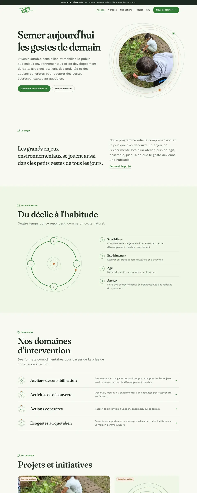
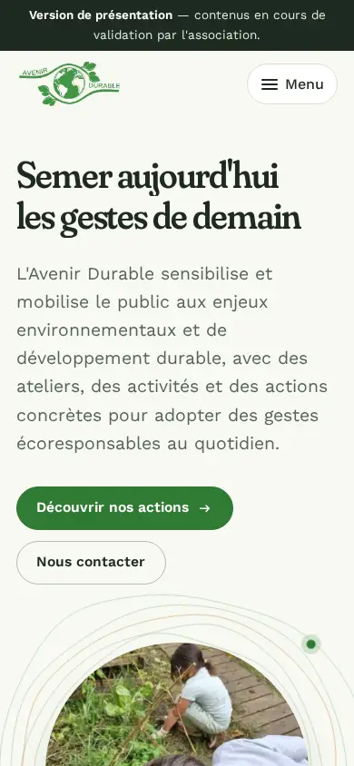
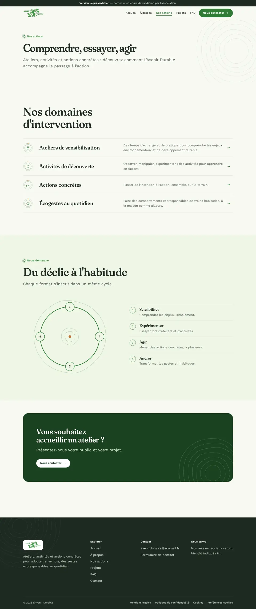
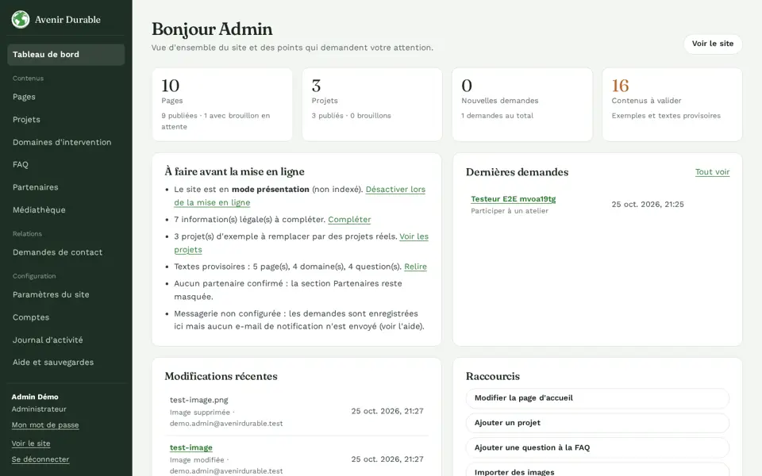
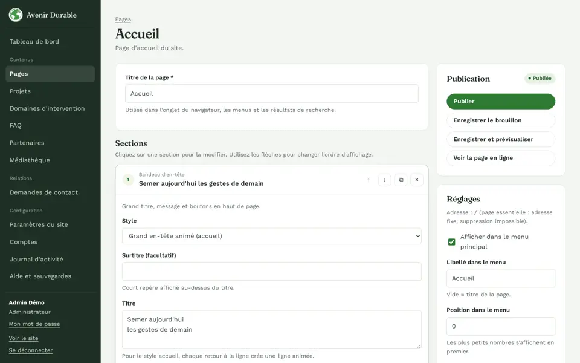

# Présentation — première version du site Avenir Durable

## Ce qui est livré

Un site vitrine **en ligne et fonctionnel** pour L'Avenir Durable, et un **espace d'administration** qui permet à l'association de tout modifier elle-même : textes, images, projets, questions fréquentes, coordonnées, couleurs, mentions légales.

| Accueil | Mobile |
|---|---|
|  |  |

### Une identité reconnaissable, fidèle à l'existant

- Le **logo**, le **vert** et la **police Work Sans** du site actuel sont conservés ; le vert est légèrement assombri pour que les textes et boutons restent lisibles par tous (contraste AA).
- Signature visuelle : les **cernes de croissance** d'un chêne — clin d'œil à la vidéo de glands publiée par l'association et image du temps long qu'il faut pour changer durablement ses habitudes. Les anneaux entourent la photo des enfants au potager, rythment les sections et le pied de page.
- Un accent brun « gland » discret, des titres en Fraunces, une mise en page éditoriale aérée.

### Un mouvement au service du propos

- À l'ouverture : le titre apparaît ligne à ligne, les cernes se dessinent autour de la photo, deux graines tournent lentement en orbite (la coopération).
- La démarche **Sensibiliser → Expérimenter → Agir → Ancrer** est présentée en cycle qui se trace au défilement.
- Micro-interactions sur les boutons, le menu, les domaines. Tout est désactivé si le visiteur a demandé à réduire les animations, et le site reste lisible sans JavaScript.

### Les pages

Accueil · À propos · Nos actions (et une page par domaine) · Projets (et une page par projet, avec filtres) · FAQ · Contact · Partenaires (prête, à publier dès le premier partenariat confirmé) · Mentions légales · Politique de confidentialité · Gestion des cookies · page 404.

## L'administration

| Tableau de bord | Édition d'une page |
|---|---|
|  |  |

- **Pages en sections** : on clique, on modifie, on réordonne, on prévisualise, on publie. Un brouillon n'est jamais visible tant qu'il n'est pas publié.
- **Projets, domaines, FAQ, partenaires** : ajout, modification, ordre, publication.
- **Médiathèque** : glisser-déposer, optimisation automatique, texte alternatif, remplacement.
- **Demandes de contact** : centralisées, avec statut nouveau / traité / archivé.
- **Paramètres** : identité, couleurs, coordonnées, réseaux sociaux, référencement, mentions légales, cookies.
- **Comptes nominatifs** (administrateur / éditeur) et **journal** des opérations.

## Sécurité et RGPD, pensés dès le départ

- Connexion protégée (mots de passe chiffrés, blocage après 5 erreurs, sessions limitées, mot de passe temporaire à changer).
- Aucun cookie ni outil de suivi pour les visiteurs, aucune ressource externe ; consentement prêt si un service est ajouté un jour.
- Formulaire anti-spam, données minimales, conservation limitée à 12 mois (modifiable).
- Pages légales générées automatiquement, avec les informations manquantes signalées **« À compléter »**.

## Ce que nous devons valider ensemble

1. **Identité juridique** : statut, numéro RNA/SIREN, adresse, directeur·rice de la publication, hébergeur.
2. **Lien avec Avenir Durable International** (avenirdurable.org) : nous l'avons traité comme une structure distincte faute d'élément le confirmant.
3. **Thématiques, publics et territoire** d'intervention ; relecture des textes des domaines et des valeurs.
4. **Projets réels** : les 3 projets actuels sont des exemples, signalés comme tels.
5. **Partenaires** confirmés et autorisation d'utiliser leur logo.
6. **Réseaux sociaux**, **logo vectoriel**, **photos** supplémentaires et autorisations de droit à l'image.
7. Relecture des pages légales, puis mise en ligne officielle (le site est pour l'instant une version de présentation non indexée).

## Qualité

27 scénarios de navigation testés automatiquement (dont la sécurité de l'administration), 31 tests techniques, build de production sans erreur. Détail : [TESTS.md](TESTS.md).
